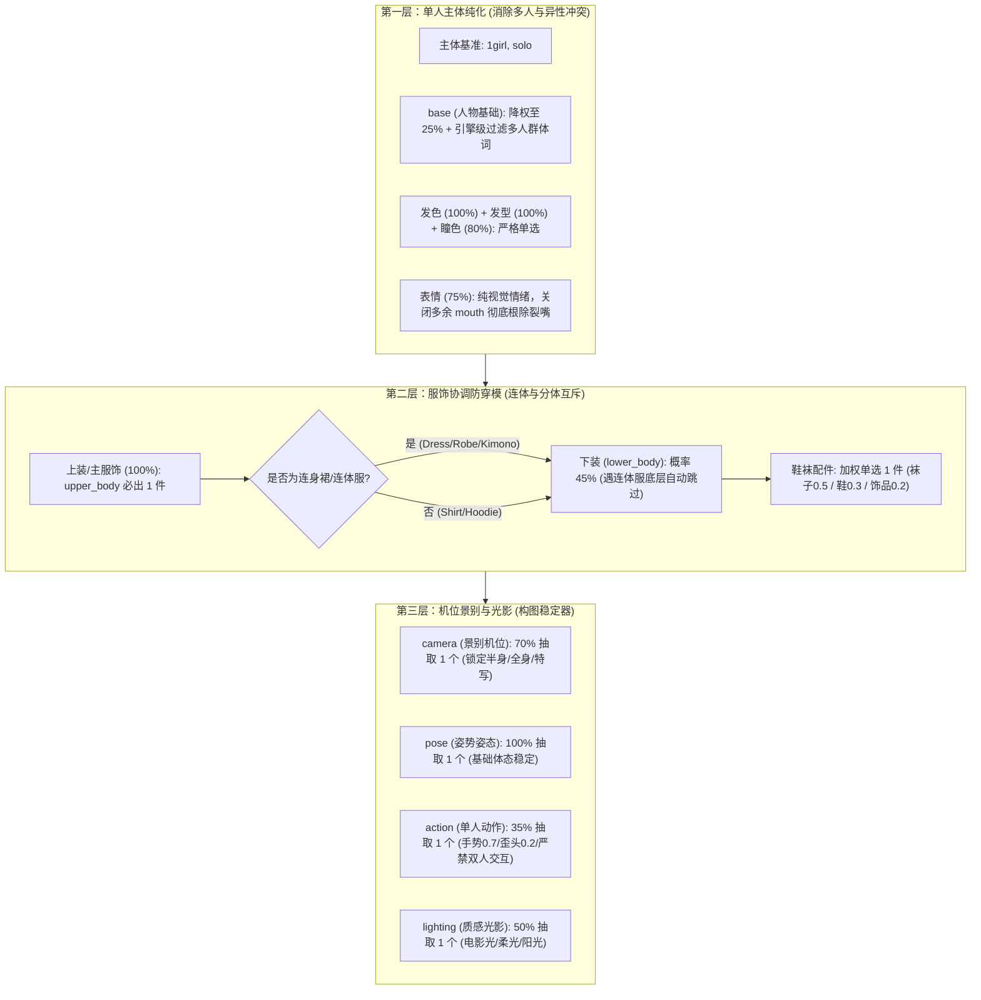

<div align="center">

# 🎨 Danbooru-Prompt
### 现代化二次元 AI 绘画提示词智能编排与可视化角色库工作台

**零依赖 · 纯原生 · 极速离线 · 本地文件实时双向同步 · 原生适配主流二次元绘图生态**

[](https://github.com/JohnKing1314/Danbooru-Prompt)
[](https://nodejs.org/)
[](LICENSE)
[](tags/)
[](img/)
[](https://github.com/JohnKing1314/Danbooru-Prompt)

<p align="center">
  <a href="#-核心亮点与数据规模">核心亮点</a> •
  <a href="#-全新防撕裂黄金规则抽卡引擎">防撕裂抽卡</a> •
  <a href="#-详细功能特性">功能全览</a> •
  <a href="#-快速启动指南">快速启动</a> •
  <a href="#-词库分类架构">词库架构</a> •
  <a href="#-快捷键速查">快捷键</a>
</p>

</div>

---

## 🌟 核心亮点与数据规模

| 模块 | 规模与内容 | 核心特性说明 |
| :--- | :--- | :--- |
| **精选分类词库** | **8 大主分类 · 65 个子分类 · 19,535 条** | 100% 中英对照、四级阶梯分级（蓝/黄/橙/红），阶梯式界定日常全年龄、轻度敏感、进阶私密与核心限制级内容 |
| **离线全量词典** | **33.6 万** Danbooru 全量词条 + **19.8 万** 别名规范映射表 | 毫秒级拼音/汉字/英文模糊联想补全，支持别名自动纠正标准词 |
| **可视化角色库** | **2,062 名** 二次元热门角色（游戏/番剧/VTuber） | **100% 配套 240×260 高清立绘**，一键套用角色触发词与完整外观 Tags |
| **智能抽卡引擎** | **V1.2.3 加权规则引擎 + 防撕裂黄金法则** | 连身裙防穿模拦截、单人主体纯化、机位景别与质感光影黄金通道 |
| **统一预设与模板** | **300 套** 场景/风格预设 · **13 套** 成品模板 · 自由方案库 | 支持多预设叠加（`＋`）、独立方案保存，修改实时双向落盘 |
| **双引擎本地微服务** | **Node.js 零依赖主引擎** + Python 3 备用引擎 | 内置 Gzip 压缩、原子镜像备份、路径穿越安全加固，极速丝滑响应 |

---

## 🎲 全新防撕裂黄金规则抽卡引擎（V1.2.3）

针对二次元 AI 绘图常见的“画面撕裂”（如裙子外画牛仔裤、单人画面伸出断肢、同人角色被随机改发色、厚重大衣与贴身私密衣着冲突等逻辑矛盾），本工作台内建了**四重防撕裂架构**：



### 四大快捷开关最佳配置指南

| 开关名称 | 默认状态 | 最佳定位与机制 | 推荐适用场景 |
| :--- | :---: | :--- | :--- |
| **含质量词** (`sw_quality`) | **ON** | 注入 `masterpiece, best quality, score_7` 等前缀，固定抽取 1 个质感风格词，消除塑料感。 | **日常几乎必开**（仅在使用写实摄影底模或特定强风格 LoRA 时关闭） |
| **含画师** (`sw_artist`) | **OFF** | 固定抽取 1 个画师标签（带 `@` 前缀），严禁多画师混抽。 | 寻找画风灵感、抽画风盲盒时开启；使用角色 LoRA 时建议关闭 |
| **含角色** (`sw_char`) | **OFF** | 点名动漫角色，**100% 屏蔽 30 个人物外貌与服装通道**，特征权全交角色自身。 | **同人二创盲盒抽卡**；关闭时为纯原创 OC 抽卡模式 |
| **含nsfw** (`sw_nsfw`) | **OFF** | 自动屏蔽下装长裤，优先抽取私密贴身衣饰（0.45）与微露细节（0.40），保底 2 个进阶词。 | 进阶与成人向创作，彻底杜绝“常态外装与贴身私密衣着冲突”的诡异融合图 |

---

## 🔍 详细功能特性

### 1. 右侧已选提示词工作台（高频专业编辑与快捷操作）
- **单击 Tag 文本区域（临时屏蔽 / 排除）**：单击右侧已选列表中任意标签文字区域，该标签立即切换为“临时禁用”状态（呈现半透明删除线）；生成最终提示词或点击复制时**自动忽略排除**，再次单击立即恢复。
- **双击 Tag 最左侧区域（精准分类快速定位）**：双击已选标签的最左侧边缘区域，中间分类树将**自动展开、平滑滚动跳转并高亮闪烁**该词条所属分类，便于快速比对和替换同类词。
- **鼠标悬停滚轮微调权重（免手动输入）**：将鼠标指针悬停在权重数字区域，直接滚动滚轮即可微调权重（默认每次 `±0.05`；按住 `Shift` 键滑动滚轮加速为 `±0.1`）；在文字区域滚动则正常滚动提示词列表，互不干扰。
- **拖拽左侧 `⋮⋮` 手柄自由排序**：按住词条最左侧的竖向拖拽手柄，上下拖拽即可自由调整提示词的前后排列顺序。
- **标签锁定 (`🔒`) 与角色分组管理**：点击 `🔒` 锁定标签后，「清空列表」或「随机抽词」时保留；角色特征词自动折叠归组，支持一键锁定整套角色特征。
- **多平台权重语法一键切换**：底部状态栏支持在 **`WebUI`** `(tag:1.2)`、**`NovelAI`** `{tag}` / `[tag]`、**`Anima`** `(tag:1.2)` 三种主流格式间秒级切换并一键复制到剪贴板。

### 2. 全库极速检索、实时联想与别名纠偏
- **多维度置顶检索**：支持英文、中文、拼音首字母检索，精确项置顶，其余项按热度与相关性智能展现。
- **毫秒级离线联想补全**：输入 2 个字符以上即时弹出覆盖 33.6 万词条的联想浮窗，键盘 `↑`/`↓` 选择、`Tab`/`Enter` 补全。
- **Danbooru 别名自动标准化**：输入历史旧词或非标准别名（如 `twintail`）时，自动提示并一键纠偏为 Danbooru 官方规范词（如 `twintails`）。

### 3. 2,062 名全高清立绘可视化角色库
- **三大分类 · 47 个细分作品**：
  - 🎮 **游戏类（1,287 名）**：《蔚蓝档案》（158）、《明日方舟》（153）、《原神》（132）、《崩坏：星穹铁道》（109）、《东方Project》（95）、《鸣潮》（73）、《碧蓝航线》（62）等。
  - 📺 **番剧类（720 名）**：《赛马娘》（125）、《偶像大师》（178）、《Fate》（63）、《Love Live!》（50）、《BanG Dream!》（44）等热门名作。
  - 🎤 **VTuber类（55 名）**：主流 hololive 成员全覆盖。
- **一键套用与自定义立绘**：点击角色大卡即可自动注入角色名及专属服饰发型 Tag；支持拖拽本地图片自定义替换立绘。

### 4. 精准四级安全阶梯与 NSFW 一键隔离
- 🔵 **全年龄 (`g: General`)**：日常安全、全年龄衣饰；
- 🟡 **轻度敏感 (`s: Sensitive`)**：泳装比基尼、紧身衣轮廓、轻微露肤、战斗血迹；
- 🟠 **进阶私密 / 存疑 (`q: Questionable`)**：私密穿着、微露细节、特殊亲密互动与情调氛围词；
- 🔴 **限制级 / 成人向 (`e: Explicit`)**：核心限制级互动与进阶成人向场景。
- 顶部设有一键 NSFW 开关，关闭状态下全库及离线联想自动过滤敏感词汇，公开展出安全可靠。

### 5. 统一扩展库目录（`libraries/`）
- **预设库（`libraries/presets/`，300 个）**：分类筛选、多预设点击 `＋` 叠加、导入导出；
- **成品模板库（`libraries/templates/`，13 套）**：沉浸式多段式模板编辑；
- **抽卡方案库（`libraries/random_schemes/`）**：支持将调优后的规则另存为独立方案，修改实时回写 `.json`。

---

## 📂 词库分类架构

全库经过专业清洗与去重，当前收录标签总数严格等于 **19,535** 条，阶梯分布清晰：

| 大分类 | 目录路径 | 子分类数 | 标签数 | 覆盖核心内容 |
| :--- | :--- | :---: | :---: | :--- |
| 🎨 **画风** | `tags/style_group/` | 6 | 3,440 | 艺术风格、机位景别 (`camera`)、光影渲染 (`lighting`)、画质等 |
| 👤 **人物基础** | `tags/character_base/` | 23 | 2,949 | 发色、发型、面部表情、瞳色、生理结构等 |
| 🏃 **动作** | `tags/action_group/` | 6 | 3,022 | 姿势姿态 (`pose`)、单人手势、头部动作、肢体动作等 |
| 👗 **服饰** | `tags/outfit_group/` | 14 | 4,889 | 上装/连身装、下装、内衣、鞋袜、头饰配饰等 |
| 🎒 **道具** | `tags/props_group/` | 5 | 2,820 | 日常物件、食物、武器、特殊道具等 |
| 🏙️ **场景** | `tags/scene_group/` | 5 | 1,068 | 自然风景、室内场景、天候时间、城市建筑等 |
| 📦 **未分类** | `tags/uncategorized_group/` | 5 | 1,219 | 视觉特效、元素符号、抽象概念等 |
| ⛔ **负面词** | `tags/negative/` | 1 | 128 | 通用低画质基线负面提示词 |
| **全库总计** | — | **65** | **19,535** | **无重复 · 零丢失 · 结构纯净** |

---

## 🚀 快速启动指南

### 双启动模式对比与选择（重要）

本项目提供两种启动运行方式，以满足不同场景需求：

| 启动模式 | 操作方法 | 文件修改与持久化支持 | 适用场景与特性说明 |
| :--- | :--- | :---: | :--- |
| **🚀 双击 `启动.bat`<br>*(强烈推荐)*** | 双击根目录下 **`启动.bat`** | ✅ **完全支持**<br>*(实时双向落盘)* | • **推荐日常使用**：自动检测环境并启动本地极速微服务（优先 Node.js 零依赖服务，自动回退 Python 3）；<br>• **支持文件实时修改与持久化**：用户在界面上进行的标签管理、增删分类、预设方案调整、立绘拖拽替换等操作均会**直接实时写回本地磁盘文件**，下次启动依然完全保留。 |
| **🌐 直接打开 `html`<br>*(纯静态离线模式)*** | 直接双击 **`danbooru_prompt.html`** | ❌ **不支持持久化**<br>*(单次会话重置)* | • **免环境极速开箱**：完全无需安装 Node.js 或 Python 环境，任何电脑双击即开，纯浏览器前端运行；<br>• **单次会话使用（刷新重置）**：受浏览器本地沙箱安全策略限制，**无法直接修改磁盘源文件**。用户所作的临时编辑与调词仅在当前网页会话中生效，**刷新网页或关闭浏览器后会自动重置**为初始状态。适合临时快速拼词。 |

### 环境要求与准备
- **操作系统**：Windows 10 / 11、macOS 或 Linux
- **运行环境**：Node.js >= 18.0.0（强烈推荐，启动服务用）或 Python 3.8+；若仅以纯静态离线模式运行 HTML 则无需任何环境。

1. 克隆或下载本项目至本地任意目录：
   ```bash
   git clone https://github.com/JohnKing1314/Danbooru-Prompt.git
   cd Danbooru-Prompt
   ```
2. **日常使用推荐**：双击运行根目录下的 **`启动.bat`**，程序将自动在可用端口启动本地微服务并弹出浏览器访问页面。

### 命令行直接启动（开发者模式）
```bash
# Node.js 极速主服务启动（推荐，支持实时双向落盘）
node tag-server.mjs

# 或使用 Python 备用服务启动
python script/tag_server.py
```

---

## ⌨️ 常用快捷键速查

| 快捷键 | 功能说明 | 适用场景 |
| :--- | :--- | :--- |
| **`/`** | 快速聚焦至顶部全局搜索框 | 任意界面快速查找标签 |
| **`Ctrl + Enter`** | 一键复制当前格式化好的最终提示词 | 快速粘贴至 WebUI / ComfyUI / NAI |
| **`Ctrl + A`** | 全选当前分类列表下的所有可见标签 | 批量操作 |
| **`Ctrl + I`** | 反选当前分类列表下的标签 | 批量操作 |
| **`Ctrl + D`** | 取消当前所有选中状态 | 批量操作 |
| **`Esc`** | 逐层关闭当前打开的所有模态弹窗或浮层 | 界面快速复位 |

---

## 📁 目录结构组织

```text
Danbooru-Prompt/
├── 启动.bat                   # Windows 一键启动脚本
├── tag-server.mjs             # Node.js 零依赖高性能同步主服务
├── danbooru_prompt.html       # 工作台核心单页应用入口
├── js/                        # 前端逻辑核心
│   ├── app.js                 # 核心交互逻辑与 V1.2.3 抽卡规则引擎
│   ├── app-layout.js          # 界面布局与组件模板
│   ├── ai.js                  # AI 接口直连与提示词扩写
│   └── external-fs-engine.js  # 本地文件实时同步通信引擎
├── tags/                      # 模块化精选词库与离线全量词典
│   ├── _characters_/          # 2,062 名角色分类数据与关联关系
│   ├── _offline_db_/          # 33.6万全量词典与19.8万别名表
│   ├── tags-loader.js         # 前端极速预编译离线加载器 (19,535 Tags)
│   └── index.json             # 分类与词条总清单索引
├── img/                       # 角色 240×260 展示立绘库
├── libraries/                 # 统一扩展库目录
│   ├── presets/               # 300 套精选预设库
│   ├── templates/             # 13 套多段式成品模板
│   └── random_schemes/        # 防撕裂抽卡方案库
└── materials/                 # UI 图标与矢量设计资源
```

---

## 📄 开源许可与致谢

- 本项目遵循 **MIT License** 开源许可协议。
- 标签数据归属与标准化规范基于 [Danbooru](https://danbooru.donmai.us/) 社区共识。
- 欢迎提交 Issue 与 Pull Request 共同完善二次元 AI 绘画生态！
